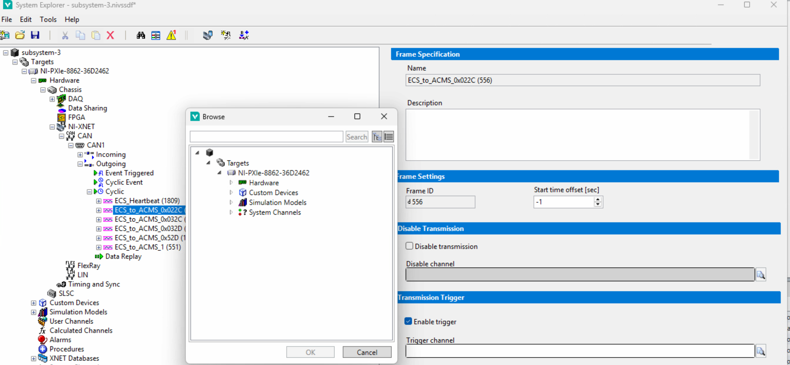

# PXI-CAN-Switch

关于PXI CAN报文的发送功能 如何通过Veristand关闭/开启

**需求：**

有一个真实的器件A和它的模拟件A'，他们都给第三方B发送同样的CAN报文。

A‘从属于PXI中的模型，A则是一个嵌入式设备。A'通过PXI的CAN卡发送CAN报文，A则通过其内部的CAN芯片发送。

大部分时候会使用A', 但是偶尔有联合仿真的需求，要用A，此时就需要关闭A'的CAN报文发送功能，不然两者同时发送同样的报文，会出现冲突。

**解决方法**

Veristand自带CAN报文使能功能。需要再Hardware中定位到具体的CAN报文，如图所示。然后同时勾选Veristand System Explorer中的Disable transmission和Trigger channel，并分别给两者绑定信号。

